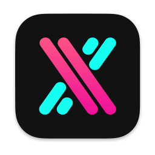
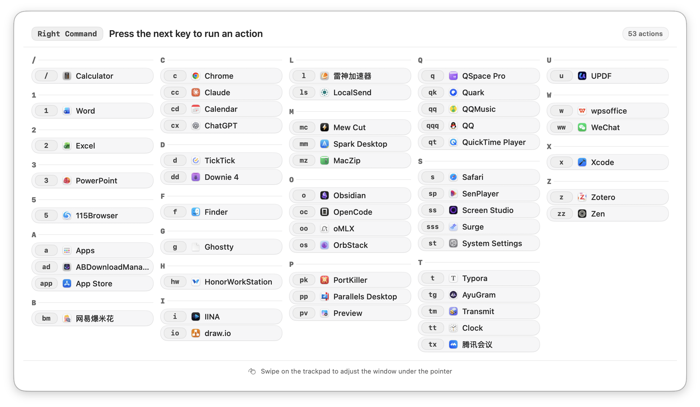
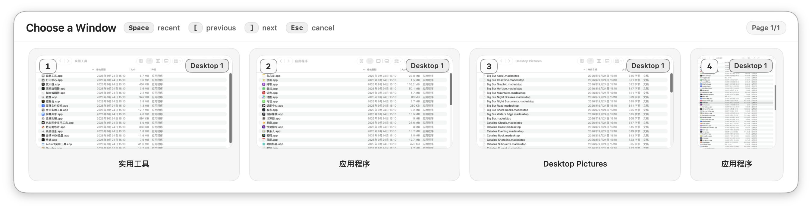
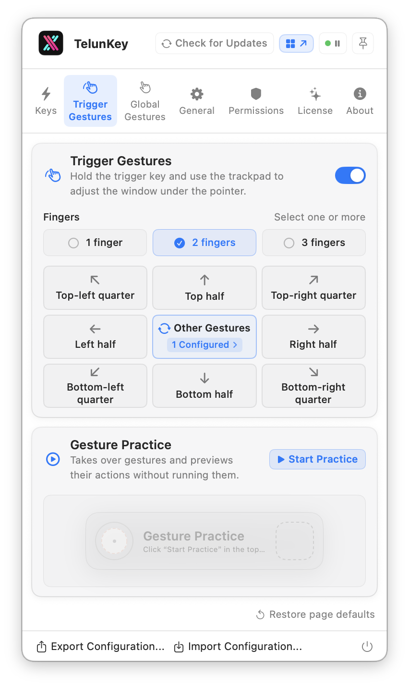

<div align="center">



# TelunKey

**macOS के लिए विंडो स्विचिंग · कीबोर्ड और ट्रैकपैड**

ट्रिगर कुंजी दबाए रखें और एक से तीन कुंजियाँ दबाकर किसी भी ऐप या विंडो तक पहुँचें। ट्रैकपैड पर स्वाइप करके उसे जगह पर रखें।

[](https://github.com/telungit/TelunKey/releases/latest)


[telunkey.shop](https://www.telunkey.shop)

[इंस्टॉल करें](#install) · [प्रतिक्रिया](#feedback)

[简体中文](./README.md) | [繁體中文](./README.zh-Hant.md) | [English](./README.en.md) | [日本語](./README.ja.md) | [한국어](./README.ko.md) | [Español](./README.es.md) | [Português](./README.pt.md) | हिन्दी | [Русский](./README.ru.md) | [Français](./README.fr.md) | [Deutsch](./README.de.md) | [العربية](./README.ar.md)

</div>

## सीधी कुंजियाँ

ट्रिगर कुंजी (बाईं / दाईं Command, बाईं / दाईं Option या Space) दबाए रखें और ऐप को असाइन की गई एक से तीन कुंजियाँ दबाएँ। ऐप खुला नहीं है तो वह खुलता है; एक विंडो है तो सामने आती है; कई विंडो हैं तो सेलेक्टर दिखता है। ट्रिगर कुंजी दबाए रखने के दौरान सभी बाइंडिंग देखी जा सकती हैं।



## कीबोर्ड सेलेक्टर

सेलेक्टर विंडो के थंबनेल कीबोर्ड क्रम में दिखाता है: 1–0, Q–P, A–L, Z–M, हर पृष्ठ पर अधिकतम 36 विंडो। संबंधित अंक या अक्षर की कुंजी दबाकर चुनें।

- स्पेस: पिछली इस्तेमाल की गई विंडो पर लौटें
- दूसरे डेस्कटॉप की विंडो पर उसका डेस्कटॉप लिखा होता है
- [ और ] से पेज बदलें, Esc से रद्द करें, या बस क्लिक करें



## ट्रिगर जेस्चर

ट्रिगर कुंजी दबाए रखें और चालू की गई एक, दो या तीन उँगलियों से स्वाइप करके पॉइंटर के नीचे की विंडो को आधे, चौथाई या अधिकतम आकार में रखें।

- ऊपर, नीचे, बाएँ, दाएँ: आधी स्क्रीन। चार तिरछी दिशाएँ: चौथाई
- उँगली उठाए बिना ऊपर फिर नीचे: मैक्सिमाइज़, मेनू बार और Dock बने रहते हैं
- रद्द क्षेत्र में जाएँ तो रद्द, वापस आएँ तो फिर चुनें

<p align="center"></p>

## तीन और चार उँगलियों वाले ग्लोबल जेस्चर

ट्रिगर कुंजी की ज़रूरत नहीं। तीन उँगलियों के स्वाइप और आने-जाने के संकेत, साथ ही तीन या चार उँगलियों के टैप, डबल टैप और भौतिक क्लिक को शॉर्टकट, एकल कुंजी, मध्य क्लिक या विंडो संचालन से जोड़ें। छूकर रखना स्क्रीन के बीच विंडो ले जाने के लिए तय है। कार्रवाइयाँ पॉइंटर के नीचे तय की गई विंडो पर लागू होती हैं।

नई स्थापना में चालू रहता है; अपडेट मौजूदा सेटिंग्स रखते हैं। लंबा स्पर्श स्क्रीन बदलने के लिए तय है। बाकी जेस्चर बदले जा सकते हैं; अभ्यास केवल पूर्वावलोकन दिखाता है।

तीन उँगलियों से स्वाइप या स्पर्श बनाए रखकर स्क्रीन चुनने से पहले सिस्टम का तीन उँगलियों वाला ड्रैग बंद करें और क्षैतिज व लंबवत स्वाइप को चार उँगलियों पर बदलें या बंद करें। TelunKey केवल चालू टकराव दिखाता है और ट्रैकपैड → अधिक जेस्चर या सुलभता → पॉइंटर नियंत्रण → ट्रैकपैड विकल्प खोलता है। लौटने पर अपने आप दोबारा जाँच होती है; बाद में सेटअप भी कर सकते हैं। टकराव दूर होने तक तीन उँगलियों के स्वाइप और लंबे स्पर्श काम नहीं करते, लेकिन टैप और क्लिक उपलब्ध रहते हैं। सिस्टम के खोज जेस्चर का टकराव अलग दिखता है। TelunKey सिस्टम सेटिंग्स अपने आप नहीं बदलता।

## दबाए रखकर स्क्रीन बदलें

बाएँ, दाएँ या ऊपर? छूकर रखने पर macOS के डिस्प्ले क्रम वाला नक्शा खुलता है। इच्छित स्क्रीन तक सरकाएँ, फिर उँगलियाँ उठाकर विंडो ले जाएँ।

- चार उँगलियाँ स्थिर रखकर स्पर्श बनाए रखें, फिर स्क्रीन चुनने के लिए खिसकाएँ। सेटअप के बाद तीन उँगलियाँ या ट्रिगर कुंजी दबाकर चालू की गई एक से तीन उँगलियाँ भी इस्तेमाल कर सकते हैं
- डिस्प्ले क्रम से चुनें; विंडो दोनों स्क्रीन के उपयोगी क्षेत्र के अनुपात में रखी जाती है
- पुष्टि से पहले लौट सकते हैं; मूल स्क्रीन या खाली जगह पर उँगलियाँ उठाने से रद्द होता है। Esc दबाकर भी रद्द कर सकते हैं।

सामान्य चार उँगलियों वाले स्वाइप macOS संभालता है। पहले चार उँगलियाँ स्थिर रखकर स्पर्श बनाए रखें। स्क्रीन चयन शुरू होने पर ही TelunKey उस जेस्चर को अस्थायी रूप से संभालता है। उँगलियाँ उठाने पर नियंत्रण सिस्टम को लौट जाता है।

दूसरे डिस्प्ले पर अभी दिख रहे डेस्कटॉप पर। एक ही डिस्प्ले में कोई गंतव्य नहीं होता। फ़ुल-स्क्रीन विंडो और फ़ुल-स्क्रीन ऐप दिखाने वाले डिस्प्ले शामिल नहीं हैं। मूल स्क्रीन, खाली जगह या अनुपलब्ध स्क्रीन पर उँगलियाँ उठाने से रद्द होता है। ट्रिगर जेस्चर में उँगलियाँ उठने तक ट्रिगर कुंजी दबाए रखें; पहले छोड़ना भी रद्द करता है।

## संचालन और सेटिंग्स

पूरी तरह Swift में लिखा गया, किसी तृतीय-पक्ष निर्भरता के बिना, मेनू बार में रहता है। सेटिंग्स आपके Mac पर रहती हैं और इन्हें आयात-निर्यात किया जा सकता है; इंटरफ़ेस 12 भाषाओं में उपलब्ध है।

https://github.com/user-attachments/assets/bf6afeee-3813-410c-87db-9696f364cea7

<a id="install"></a>

## शुरुआत करें

macOS 14 या बाद का संस्करण और [Homebrew](https://brew.sh/) आवश्यक है:

```bash
brew install --cask telungit/tap/telunkey
```

पहली बार खोलने पर सेटअप गाइड अनुमतियों, ट्रिगर कुंजियों, शॉर्टकट और जेस्चर की सेटिंग में आपकी मदद करता है। ऐप के भीतर से अपडेट करें, या चलाएँ:

```bash
brew upgrade --cask --greedy telungit/tap/telunkey
```

## अनुमतियाँ

| अनुमति | उपयोग |
| --- | --- |
| एक्सेसिबिलिटी (आवश्यक) | ट्रिगर कुंजियाँ और जेस्चर पहचानना; विंडो बदलना और व्यवस्थित करना |
| स्क्रीन रिकॉर्डिंग (वैकल्पिक) | विंडो थंबनेल; इसके बिना ऐप आइकन दिखते हैं और स्विचिंग चलती रहती है |

<a id="feedback"></a>

## प्रतिक्रिया

- [GitHub Issues](https://github.com/telungit/TelunKey/issues)
- [Telegram](https://t.me/telungram)
