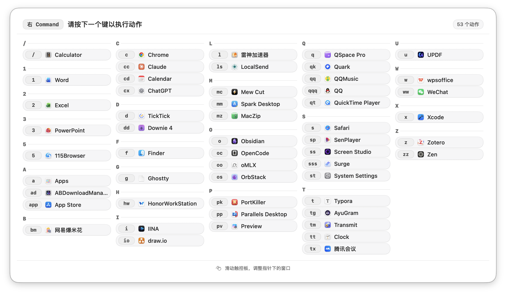
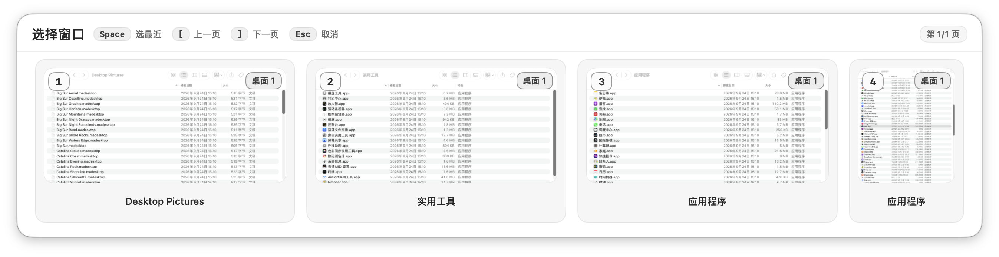
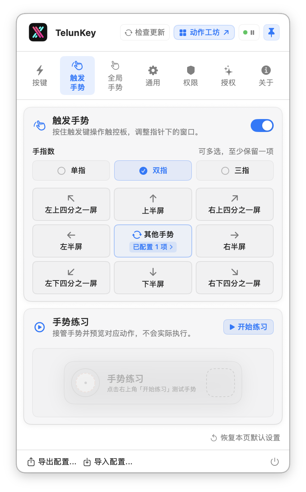

<div align="center">


# TelunKey

**macOS 窗口切换 · 键盘与触控板**

按住触发键，一到三个键直达应用与窗口；触控板一滑，把窗口摆好。

[](https://github.com/telungit/TelunKey/releases/latest)


[telunkey.shop](https://www.telunkey.shop)

[安装](#快速上手) · [反馈](#反馈)

简体中文 | [繁體中文](./README.zh-Hant.md) | [English](./README.en.md) | [日本語](./README.ja.md) | [한국어](./README.ko.md) | [Español](./README.es.md) | [Português](./README.pt.md) | [हिन्दी](./README.hi.md) | [Русский](./README.ru.md) | [Français](./README.fr.md) | [Deutsch](./README.de.md) | [العربية](./README.ar.md)

</div>

## 按键直达

按住触发键（左 / 右 Command、左 / 右 Option 或空格），输入绑定的一到三个键。应用未运行时会打开；只有一个窗口时直接聚焦；有多个窗口时显示选择器。按住触发键期间可查看全部绑定。



## 键位选择器

选择器按键盘布局排列窗口缩略图：1–0、Q–P、A–L、Z–M，每页最多 36 个窗口。按对应的数字或字母键选择。

- 空格：回到最近用过的那个窗口
- 其他桌面的窗口会标出所在桌面
- [ 和 ] 翻页，Esc 取消，也可以直接点



## 触发手势

按住触发键，用已启用的单指、双指或三指滑动，将鼠标下的窗口放到半屏、四分之一屏或最大化。

- 上下左右：半屏；四个斜向：四分之一屏
- 不抬手先上再下：最大化，保留菜单栏和 Dock
- 滑进取消区就取消，滑回来还能重选

<p align="center"></p>

## 三指与四指全局手势

无需按住触发键。三指滑动、往返，以及三指或四指的轻点、双击与按下点击，都能绑定快捷键、单键、鼠标中键或窗口操作。长触固定用于移屏。动作作用于本轮锁定的鼠标下窗口。

全新安装默认开启，升级保留原设置。长触固定用于移屏，其余手势可重新映射；练习模式只预览、不执行。

三指滑动与长触选屏需要先关闭系统三指拖移，并将系统三指横向、纵向滑动改为四指或关闭。TelunKey 只列出实际开启的冲突项，分别引导前往“触控板 → 更多手势”和“辅助功能 → 指针控制 → 触控板选项”；返回后自动检查，也可稍后设置。冲突未解决时，三指滑动与长触暂不接管，点按仍可单独使用；系统轻点查询的冲突另行提示。TelunKey 不会自动修改系统设置。

## 长触移屏

显示器在左边、右边，还是上方？长触展开与系统布局一致的小地图，滑到想去的屏幕，抬手再移动窗口。

- 四指先长触，再滑动选屏；也支持完成设置后的三指，或按住触发键用已启用的一至三指
- 按显示器逻辑布局选屏，窗口按两屏可用区域比例落位
- 确认前可以滑回；在来源屏或空白处抬手取消；也可按 Esc 取消。

普通四指滑动仍由 macOS 处理。四指先长触，成功进入选屏后才临时接管本次手势，抬手后恢复系统手势。

只能移到其他显示器当前显示的桌面。单屏没有可移入目标；全屏窗口不执行，正在显示全屏应用的目标屏不可选。来源屏、空白或不可用屏上抬手取消；触发手势需保持触发键按住，提前松键也会取消。

## 运行与配置

纯 Swift 编写，没有第三方依赖，常驻菜单栏。配置保存在本机，可导入导出；界面支持 12 种语言。

https://github.com/user-attachments/assets/bf6afeee-3813-410c-87db-9696f364cea7

## 快速上手

需要 macOS 14 及以上，并已安装 [Homebrew](https://brew.sh/)：

```bash
brew install --cask telungit/tap/telunkey
```

首次打开会有向导，带你完成权限、触发键、快捷键和手势设置。之后可在应用内更新，或执行：

```bash
brew upgrade --cask --greedy telungit/tap/telunkey
```

## 权限

| 权限 | 用途 |
| --- | --- |
| 辅助功能（必需） | 监听触发键与手势，切换、调整窗口 |
| 屏幕录制（可选） | 生成窗口缩略图；未授予时显示应用图标，切换不受影响 |

## 反馈

- [GitHub Issues](https://github.com/telungit/TelunKey/issues)
- [Telegram](https://t.me/telungram)
